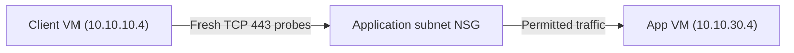
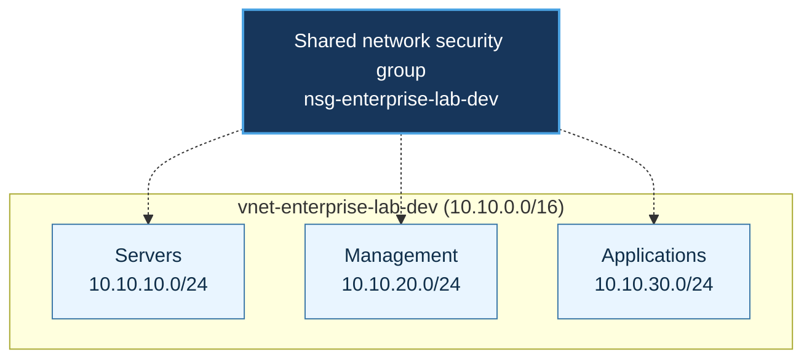

# Azure Enterprise Infrastructure Lab

**Azure NSG outage reproduced and recovered in 78 seconds between probes.** In Canada Central, two private Ubuntu VMs verified the server-to-app path. Removing one NSG rule caused TCP 443 to time out while the app stayed up. Network Watcher identified the deny rule, and redeploying the reviewed ARM template restored access.

| Phase | Guest probe on TCP 443 | Network Watcher rule |
| --- | --- | --- |
| Baseline | Passed | Allow via `allow-server-https` |
| Outage | Timed out | Deny via `deny-other-inbound` |
| Recovery | Passed 78 seconds after the first timeout | Allow via `allow-server-https` |

The final ARM what-if showed zero changes across the VNet and its three NSGs. Azure confirmed deletion of the temporary resource group.

[Incident evidence and runbook](docs/nsg-incident-lab.md#live-results) / [Deploy and clean up](docs/nsg-incident-lab.md#deploy-and-clean-up) / [Original baseline](#original-network-baseline)

## Live incident architecture



The two VMs ran in separate private subnets with dedicated subnet NSGs. TCP 8443 served as the blocked control while its app listener stayed up. The [timestamped probe results](docs/nsg-incident-lab.md#live-results) show both ports.

## Original network baseline

The original environment consists of one VNet, three private subnets, and one shared NSG.



**Resource group** `rg-enterprise-lab-dev` / **Region** Canada Central

Dotted lines indicate NSG associations. Each subnet has default outbound access disabled and no NAT gateway attached. The shared NSG uses Azure defaults, which allow traffic within the VNet and deny unmatched inbound traffic.

## Azure change review

| Preview | VNet | Network security groups | Resource deletions |
| --- | --- | --- | --- |
| Original baseline template | Modify | Shared NSG unchanged | 0 |
| Aligned baseline template | **No change** | Shared NSG unchanged | 0 |
| Segmentation proposal | Update three subnet associations | Create three dedicated NSGs. Existing shared NSG marked `Ignore` | 0 |

The first preview flagged differences in VNet settings and the subnet prefix format. I updated the template to declare the existing values and reran what-if. Azure then predicted zero changes to either baseline resource. [Before-and-after evidence](docs/segmentation.md#verification-status)

The open segmentation PR proposes narrow SSH and HTTPS allowances and a deny rule for other new inbound traffic. The proposed rules passed 12 local traffic scenarios. The Azure preview predicted that all three subnets would retain disabled default outbound access. The original environment uses the shared NSG. The disposable lab verified the private server-to-app path. [Rules, tests, and preview evidence](https://github.com/robcorbisiero/azure-enterprise-infrastructure-lab/pull/1)

## Azure evidence


The screenshot shows the original baseline on November 21, 2026. The live incident has its own Activity Log captures.

| Evidence | What to look for |
| --- | --- |
| [VNet address space](docs/screenshots/01-vnet-address-space.jpg) / [Subnet inventory](docs/screenshots/02-vnet-subnets.jpg) | The `10.10.0.0/16` VNet and the three `/24` subnets |
| [Servers](docs/screenshots/03-private-servers.jpg) / [Management](docs/screenshots/03-private-management.jpg) / [Applications](docs/screenshots/03-private-applications.jpg) | Private subnet enabled for each role |
| [Incident and recovery](docs/nsg-incident-lab.md#azure-activity-log-screenshots) | Activity Log screenshots and the runbook's timestamped probe results |
| [Cost snapshot](docs/screenshots/07-cost-snapshot.jpg) | Portal showed `0.00` current and forecast cost at capture |

The original network baseline contained only networking resources. The live exercise used two temporary VMs on the existing Azure trial. Azure confirmed deletion of both VMs with their resource group. The exercise used private IPs without a NAT gateway.

## Reproduce the checks

The [baseline ARM template](infra/network.json) targets an existing resource group. The local check uses only the Python 3 standard library. Azure what-if requires an authenticated Azure CLI session and previews changes without applying them.

```bash
python checks/check_network.py

az deployment group what-if \
  --resource-group rg-enterprise-lab-dev \
  --template-file infra/network.json \
  --mode Incremental \
  --result-format FullResourcePayloads
```

See the [operations runbook](docs/runbook.md) for portal verification, design decisions, and the connectivity test plan.


## CI and security

Pull requests run offline validation with read-only permissions. GitHub Actions dependencies are reviewed through Dependabot. See [security guidance](SECURITY.md).

See [cost and deployment change control](docs/change-control.md). Any deployment requires explicit approval; CI never deploys Azure resources.
