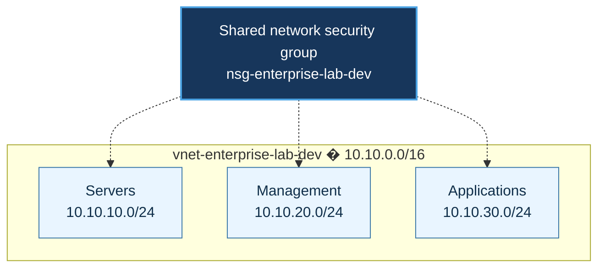
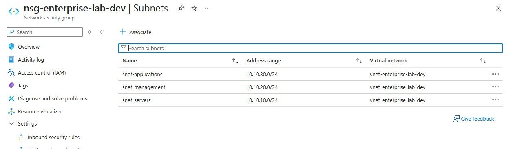

# Azure Enterprise Infrastructure Lab

A hands-on Azure networking project in **Canada Central**. It covers private subnet design, network security groups, and infrastructure change review with Azure Resource Manager (ARM) what-if.

| Deployed baseline | Azure-verified result | Security proposal |
| --- | --- | --- |
| 1 VNet, 3 private subnets, 1 shared NSG | **Zero predicted changes** after aligning the ARM template with the live VNet | **12 locally tested traffic scenarios** and a successful Azure preview in [PR #1](https://github.com/robcorbisiero/azure-enterprise-infrastructure-lab/pull/1) |

[Architecture](#deployed-architecture) � [Change review](#azure-change-review) � [Portal evidence](#azure-portal-evidence) � [Reproduce the checks](#reproduce-the-checks)

## Deployed architecture



**Resource group** `rg-enterprise-lab-dev` � **Region** Canada Central

Dotted lines indicate NSG associations. Each subnet has default outbound access disabled and no NAT gateway attached. The shared NSG uses Azure defaults, which allow traffic within the VNet and deny unmatched inbound traffic.

## Azure change review

| Preview | VNet | Network security groups | Resource deletions |
| --- | --- | --- | --- |
| Original baseline template | Modify | Shared NSG unchanged | 0 |
| Aligned baseline template | **No change** | Shared NSG unchanged | 0 |
| Segmentation proposal | Update three subnet associations | Create three dedicated NSGs. Existing shared NSG marked `Ignore` | 0 |

The first preview flagged differences in VNet settings and the subnet prefix format. I updated the template to declare the existing values and reran what-if. Azure then predicted zero changes to either baseline resource. [Before-and-after evidence](docs/segmentation.md#verification-status)

The open segmentation PR proposes narrow SSH and HTTPS allowances and a deny rule for other new inbound traffic. The proposed rules passed local checks. The Azure preview predicted that all three subnets would retain disabled default outbound access. The original environment uses the shared NSG. The private server-to-app path was tested in the disposable lab below. [Rules, tests, and preview evidence](https://github.com/robcorbisiero/azure-enterprise-infrastructure-lab/pull/1)

## Live incident exercise

The [live NSG incident and recovery lab](docs/nsg-incident-lab.md) verified private TCP 443 access, reproduced an outage by removing one NSG rule, then restored access with the reviewed ARM template. The first successful probe followed the first timeout by **78 seconds**. Network Watcher identified the rule in each phase, the final ARM preview showed zero network changes, and Azure confirmed cleanup.

## Azure Portal evidence



Captured on November 21, 2026. Screenshots are cropped to exclude account and subscription identifiers.

| Evidence | What to look for |
| --- | --- |
| [VNet address space](docs/screenshots/01-vnet-address-space.jpg) � [Subnet inventory](docs/screenshots/02-vnet-subnets.jpg) | The `10.10.0.0/16` VNet and the three `/24` subnets |
| [Servers](docs/screenshots/03-private-servers.jpg) � [Management](docs/screenshots/03-private-management.jpg) � [Applications](docs/screenshots/03-private-applications.jpg) | Private subnet enabled for each role |
| [Cost snapshot](docs/screenshots/07-cost-snapshot.jpg) | Portal showed `0.00` current and forecast cost at capture |

The lab used an existing Azure trial. This project added no compute, public IP addresses, NAT gateway, or paid network appliances. Azure usage reporting can lag.

## Reproduce the checks

The [baseline ARM template](infra/network.json) targets an existing resource group. The local check uses only the Python 3 standard library. Azure what-if requires an authenticated Azure CLI session and previews changes without applying them.

```bash
python checks/check_network.py

az deployment group what-if \
  --resource-group rg-enterprise-lab-dev \
  --template-file infra/network.json \
  --mode Incremental \
  --result-format FullResourcePayloads
```

See the [operations runbook](docs/runbook.md) for portal verification, design decisions, and the connectivity test plan.


## CI and security

Pull requests run offline validation with read-only permissions. GitHub Actions dependencies are reviewed through Dependabot. See [security guidance](SECURITY.md).

See [cost and deployment change control](docs/change-control.md). Any deployment requires explicit approval; CI never deploys Azure resources.
