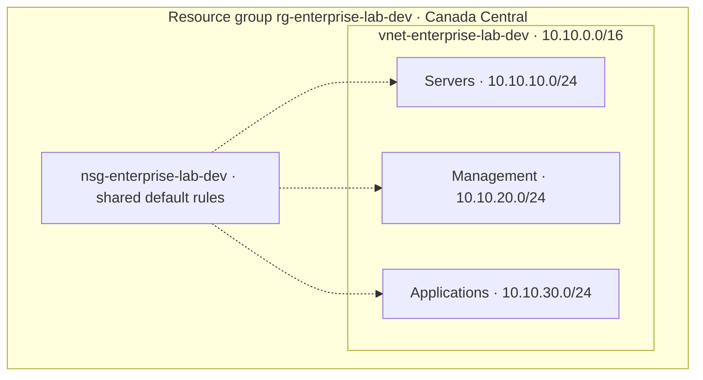

# Azure lab operations runbook

## Architecture and decisions

- Three non-overlapping /24 ranges reserve address space for distinct workload roles.
- One subnet-level NSG provides a common baseline. Azure's default rules permit VNet traffic, so subnet boundaries alone do not enforce separation between roles.
- Private subnet mode disables implicit outbound Internet access. The lab has no workload endpoints or NAT gateway.
- No VM-based tests were run. The deployed baseline was verified from the Azure control plane and documented with [portal screenshots](screenshots/).

## Verify the deployed baseline

| Azure Portal view | Expected result |
| --- | --- |
| VNet → Address space | `10.10.0.0/16` |
| VNet → Subnets | Three named /24 subnets with the shared NSG |
| Each subnet → Edit subnet | Private subnet enabled, NAT gateway set to None |
| NSG → Subnets | All three subnets associated |
| NSG → Inbound and outbound rules | Azure defaults only. `AllowVnetInBound`, `AllowAzureLoadBalancerInBound`, and `DenyAllInBound` inbound. `AllowVnetOutBound`, `AllowInternetOutBound`, and `DenyAllOutBound` outbound |
| Subscription → Overview | Cost and forecast snapshot. Usage can take time to appear |

## Preview and change control

1. Run `python checks/check_network.py` locally.
2. Run the ARM what-if command in the [README](../README.md) against the intended resource group.
3. Inspect the preview for unexpected resource, address range, subnet association, or rule changes. The template declares the complete lab subnet list and the default-only NSG baseline. Apply only after validating the target and its existing dependencies.
4. Recheck the Azure Portal views after an approved change and record the result.

## Future traffic validation

Once explicitly authorized to deploy test endpoints, define a source, destination, protocol, and port for each scenario. Use temporary private endpoints for testing only after estimating cost and specifying cleanup. Record the effective NSG rule, actual connection result, and expected result for each test.

| Scenario | Expected behavior with the current baseline |
| --- | --- |
| Management private IP to servers private IP | NSG allows VNet traffic, subject to the destination listener and host firewall |
| Applications private IP to servers private IP | NSG allows VNet traffic. Add role-specific rules if isolation is required |
| Unmatched inbound traffic from outside the VNet | Default inbound deny applies |
| Internet egress without an explicit outbound path | Private subnet configuration provides no default outbound connectivity |

For a future isolated design, document required flows first, then add scoped allows and a deny for unwanted VNet traffic. Re-run permitted and denied cases after the change.
